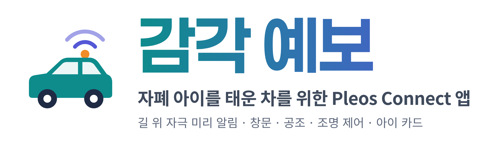
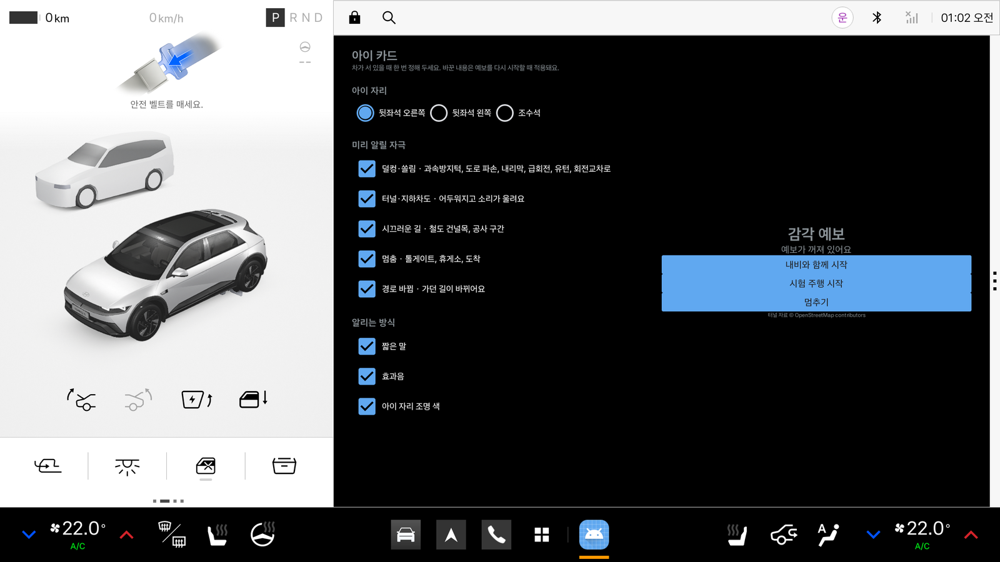
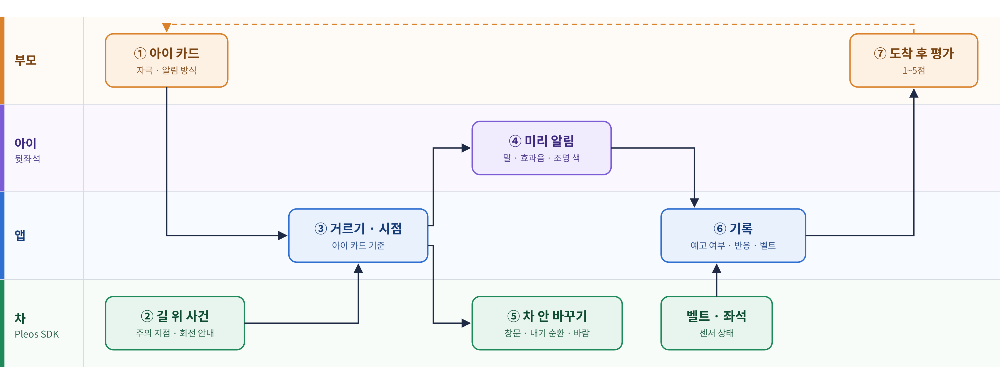

<div align="center">

<picture>
  <source media="(prefers-color-scheme: dark)" srcset="docs/img/banner-dark.png">
  
</picture>

### 자폐 아이를 태운 차를 위한 감각 예보 앱

**과속방지턱, 터널, 철도 건널목처럼 아이가 힘들어하는 길 위 자극을 차가 먼저 알고, 아이에게 미리 알리고, 창문 · 공조 · 조명을 미리 바꿉니다.**

[](https://appdevchallenge.auto-hmg.io/)
[](docs/sdk/README.md)
[](docs/sdk/README.md)
[](https://kotlinlang.org/)
[](docs/research/README.md)

[왜 감각 예보](#왜-감각-예보) · [기능](#기능) · [구조도](#구조도) · [빠른 시작](#빠른-시작) · [테스트 환경](#테스트-환경) · [폴더 구조](#폴더-구조) · [팀 규칙](#팀-규칙) · [일정](#일정) · [근거](#근거)

</div>

---

**감각 예보**는 현대자동차그룹 차량용 앱 개발 공모전 출품작입니다. Pleos Connect 내비가 아는 앞길의 사건 가운데 아이가 힘들어하는 것만 골라, 사건 직전에 짧은 말 · 효과음 · 조명 색으로 알리고 차 안 환경을 바꿉니다.

부모가 아이 카드에 아이의 감각 특성과 알림 방식을 정하면, 앱은 그 기준으로 사건을 고르고 알릴 시점을 계산합니다. 이동이 끝나면 예고한 사건과 하지 않은 사건 뒤의 반응, 벨트 풀림을 기록해 아이에게 맞는지 확인합니다.

> 이 앱은 의료 판단을 하지 않습니다. 아이에게 맞는 설정은 부모가 정하고, 예고의 효과는 아이마다 기록으로 확인합니다.

## 왜 감각 예보

| | 감각 예보 | 일반 내비 |
|---|---|---|
| 누구를 위해 | 뒷좌석의 자폐 아이 | 운전자 |
| 무엇을 알리나 | 덜컹임 · 어두움 · 큰 소리처럼 몸으로 느낄 자극 | 경로 · 단속 · 교통 정보 |
| 어떻게 알리나 | 아이가 고른 짧은 말 · 효과음 · 조명 색 | 안내 음성과 화면 |
| 미리 바꾸기 | 창문 닫기 · 내기 순환 · 바람 · 조명 | 없음 |
| 효과 확인 | 예고한 사건과 하지 않은 사건 뒤 반응을 아이마다 비교 | 없음 |

- 자폐 아동에게 차 이동은 전환과 여러 감각 자극이 한꺼번에 겹치는 일입니다.
- 메타분석 추정으로 자폐인의 41%가 지금 소리 과민을 겪고 있습니다.
- 자폐 아동은 불확실성을 견디기 어려울수록 감각에 더 민감했습니다.
- 길 위 감각 자극을 미리 알려 주는 차량용 앱은 찾지 못했습니다.

출처는 [근거 목록](docs/research/README.md)에 있습니다.

## 기능

- **아이 카드** `구현`: 아이 자리, 미리 알릴 자극, 알리는 방식을 부모가 차가 서 있을 때 정합니다.
- **길 위 사건 받기** `구현`: 내비 주의 지점과 회전 안내에서 과속방지턱 · 터널 · 지하차도 · 철도 건널목 · 고속도로 공사 구간 · 톨게이트 · 경로 변경을 받습니다.
- **미리 알리기** `구현`: 말은 사건 약 8초 전, 효과음과 아이 자리 조명 색은 약 3초 전에 알립니다. 속도는 사건까지 남은 거리가 줄어드는 빠르기로 구합니다. 화면은 쓰지 않습니다.
- **미리 바꾸기** `구현`: 소리가 큰 구간 전에 아이 쪽 창문을 닫고, 내기 순환으로 바꾸고, 바람을 약하게 합니다. 터널을 나오면 내기 순환을 원래대로 돌립니다.
- **조용한 방 모드** `최종 PT까지`: 부모가 "쉬자"라고 말하면 창문 · 커튼 · 조명 · 바람을 한 번에 바꾸고 예고를 잠시 멈춥니다.
- **기록** `최종 PT까지`: 사건, 예고 여부, 벨트 풀림, 도착 후 부모 평가를 남기고 다음 설정을 제안합니다.



<sub>Pleos Connect 에뮬레이터에서 연 아이 카드 화면입니다.</sub>

**시연 영상**: [docs/video/sensory-forecast-demo.mp4](docs/video/sensory-forecast-demo.mp4), 110초. 에뮬레이터 시험 주행에서 과속방지턱 · 터널 · 공사 구간 · 도착을 차례로 알리고, 가상 콘솔에서 창문 · 내기 순환 · 바람 · 실내 조명이 바뀌는 모습을 함께 녹화했습니다. 앱이 하는 말은 자막으로 보여 주고, 효과음은 앱이 낸 소리 그대로 넣었습니다.

## 구조도



<sub>역할별 흐름. 주황은 부모, 보라는 아이, 파랑은 앱, 초록은 차입니다. 주황 점선은 도착 후 평가로 아이 카드를 고치는 고리입니다.</sub>

① 아이 카드 → ② 길 위 사건 → ③ 거르기 · 시점 계산 → ④ 미리 알림 · ⑤ 차 안 바꾸기 → ⑥ 기록 → ⑦ 도착 후 평가

- 좌석은 달리는 중에 움직이지 않습니다.
- 운전자에게는 음성으로만 알립니다.
- 자세한 설계와 안전 규칙은 [앱 설계](docs/design/README.md)에 있습니다.

## 빠른 시작

**APK로 바로 실행**

1. Pleos Connect 에뮬레이터 v2.1.0을 켭니다.
2. `apk/` 폴더의 APK를 설치합니다.

   ```bash
   adb install -r apk/팀명_앱이름_release.apk
   ```

3. 앱 목록에서 "감각 예보"를 엽니다. 왼쪽에서 아이 카드를 고르고 오른쪽의 "시험 주행 시작"을 누릅니다.
4. 내비 경로 없이도 과속방지턱 · 터널 · 공사 구간 · 도착이 차례로 다가옵니다. 말 · 효과음 · 조명과 창문 · 내기 순환 · 바람 변화를 가상 콘솔에서 봅니다.
5. 내비 경로로 시험하려면 내비에 목적지를 넣고 "내비와 함께 시작"을 누릅니다.

**소스에서 빌드**

1. Android Studio와 JDK 17을 준비합니다.
2. [Pleos Connect 에뮬레이터 가이드](https://document.pleos.ai/docs/connect/guide/getting-started/application-development/setup-connect-sdk-emulator)를 따라 에뮬레이터 v2.1.0 이상으로 AVD를 만듭니다.
3. 이 레포를 Android Studio로 열고 Gradle 동기화를 합니다. Pleos SDK는 Pleos Maven 저장소에서 받습니다.
4. 빌드해서 에뮬레이터에 설치합니다.

   ```bash
   ./gradlew installDebug
   ```

5. 가상 콘솔을 열어 창문 · 공조 · 조명 · 좌석 상태를 바꿔 봅니다.

   ```bash
   adb forward tcp:8088 tcp:8088
   # 브라우저에서 http://127.0.0.1:8088/
   ```

SDK 버전, 권한, API, 시연 방법은 [SDK 참조](docs/sdk/README.md)에 있습니다.

## 테스트 환경

- **개발에 쓴 에뮬레이터**: Pleos Connect Emulator v2.1.0
  - AVD 이름 `Pleos_Connect_v2.1.0`, 빌드 `release_connect_v2.1.0`
  - Android 14, API 34, x86_64
  - 화면 규격 2560 × 1440, 160dpi
- **차 상태 시뮬레이션**: Pleos Connect Virtual Console. 창문 · 공조 · 조명 · 기어 상태를 보고 바꿉니다.
- **빌드**: Android Studio 또는 Gradle 8.10.2, JDK 17, compileSdk 35, minSdk 28
- **시험 주행**: 앱의 "시험 주행 시작" 버튼은 내비 없이 과속방지턱 · 터널 · 공사 구간 · 도착을 차례로 흘려보냅니다. 내비 경로가 없어도 알림과 차 제어를 볼 수 있습니다.
- 실제 차에서는 차종과 트림마다 지원 기능이 달라, 앱이 기능별 지원 여부를 먼저 확인합니다.

## APK

- 제출용 APK는 `apk/팀명_앱이름_release.apk`에 둡니다.
- `./gradlew assembleRelease`로 만든 release 빌드입니다. 바로 설치되도록 디버그 키로 서명합니다.
- 권한은 모두 매니페스트에 선언돼 있어 따로 허용할 것이 없습니다.

## 폴더 구조

```
app/src/main/java/com/sensoryforecast/
  MainActivity.kt        시작 화면
  core/                  차 없이 도는 판단 로직: 길 위 사건 · 아이 카드 · 차와의 약속
  car/                   Pleos SDK 연결 자리: 내비 · 창문 · 공조 · 조명 · 음성
  ui/                    화면 자리: 아이 카드 설정 · 상태 · 기록
apk/                     제출용 APK
docs/
  design/                앱 설계: 구성 4단계 · 상황과 대응 · 안전 규칙 · 효과 확인
  research/              근거 목록: 주장마다 논문 · 기사 링크
  sdk/                   SDK 참조: 버전 · 권한 · API · 가상 콘솔 시연
  ideas/                 팀원 아이디어 양식과 제출
  proposal/              기획서 초안
  img/                   README 그림
tools/
  pleos_api.py           Pleos API 상세 문서를 글자로 읽는 도구
  make_cues.py           효과음 다섯 개 합성
  osm_tunnels.py         OpenStreetMap에서 국내 터널 입구 목록 만들기
  demo_video/            시연 영상 녹화와 합성
  readme_images/         README 배너와 구조도 만들기
gradle/libs.versions.toml  SDK와 도구 버전
```

## 팀 규칙

- **브랜치**: `기능/설명` 형식으로 만들고, main에는 PR로 합칩니다. 예: `feat/belt-alert`
- **코드 자리**: 판단 로직은 `core`, SDK를 부르는 코드는 `car`, 화면은 `ui`에 둡니다. `core`는 SDK를 직접 부르지 않습니다.
- **버전**: SDK와 도구 버전은 `gradle/libs.versions.toml`에서만 바꿉니다.
- **아이디어**: [양식](docs/ideas/TEMPLATE.md)을 복사해 `docs/ideas/이름_아이디어.md`로 올립니다.
- **근거**: 기획서와 발표에 쓰는 주장은 먼저 [근거 목록](docs/research/README.md)에 출처를 더합니다.
- **올리지 않는 것**: 서명 키, 비밀번호, 아이 기록과 시범 데이터

## 일정

- **11-15 접수 마감**: 기획서는 필수이고, 시연 영상 · GitHub · APK를 내면 가산점이 있습니다.
- **11-23**: 1차 서류심사 결과
- **12-03 ~ 12-04 최종 PT**: 실제로 동작하는 앱 시연

## 팀

공모전 안내에 따라 이 레포와 첨부자료에는 실명, 연락처, 계정 정보를 적지 않습니다. 팀 정보는 접수양식에만 적습니다.

## 근거

- [근거 목록](docs/research/README.md): 문제, 감각과 예측, 예고와 중재, 부작용, 물리적 대응, 효과 확인 방법, 시장과 선례
- [Pleos Connect 개발 문서](https://document.pleos.ai/)
- README 그림 글꼴: Paperlogy, [Noto Sans CJK KR](https://github.com/notofonts/noto-cjk)
